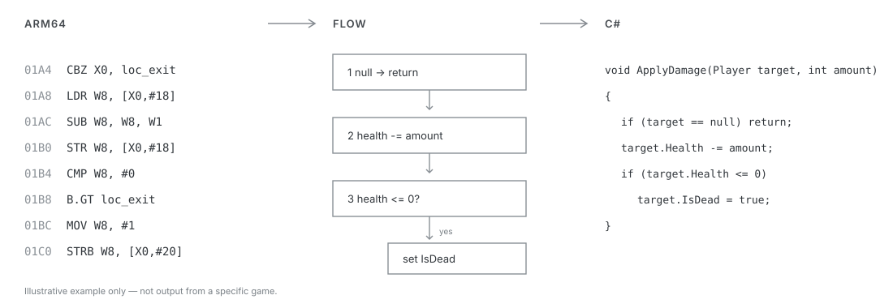

  

  
  
  
  

**MC2IL (Machine Code to IL)** analyzes Unity IL2CPP builds and reconstructs managed assemblies with recovered method bodies. It can take a Unity game folder or an Android APK and write DLLs, C#-oriented output, or an instruction-level dump.

MC2IL is an early-stage tool. IL recovery is experimental: generated methods may still contain unresolved native values or incomplete control flow.

## From native instructions to C#

  

The example is illustrative, not output from a specific game. Actual recovery results and method sizes vary by Unity version, architecture, and native code.

## What it can do

- Read Unity game folders and Android APKs, locating the IL2CPP binary and metadata automatically.
- Parse Unity IL2CPP metadata and native binaries across supported architectures.
- Produce managed DLLs with recovered method bodies, alongside stub DLLs and analysis dumps.
- Run as a command-line tool on Windows, Linux, and macOS with .NET 10.

## Quick start

Install the .NET 10 SDK, then build the solution:

    dotnet build MC2IL.slnx --configuration Release

Analyze a game APK:

    dotnet run --configuration Release --project MC2IL/MC2IL.csproj --framework net10.0 -- --game-path "C:\Games\Example.apk" --output-as dll_il_recovery --output-to mc2il_out

On Windows, Linux, or macOS, launch MC2IL without arguments to open the interactive terminal wizard. It lets you choose the game path, output format, destination, and common analysis options. The terminal progress display reports the actual method-processing count. Existing command-line arguments remain available.

    dotnet run --configuration Release --project MC2IL/MC2IL.csproj --framework net10.0

For a Windows game, pass the game folder instead:

    dotnet run --configuration Release --project MC2IL/MC2IL.csproj --framework net10.0 -- --game-path "C:\Games\Example" --output-as dll_il_recovery --output-to mc2il_out

List all output formats:

    dotnet run --no-build --configuration Release --project MC2IL/MC2IL.csproj --framework net10.0 -- --list-output-formats

The generated files are written to mc2il_out. Choose dll_il_recovery for recovered method bodies; results depend on the game, Unity version, and native code.

For source reading, add `--reuse-singleton-instances` to reuse an earlier `MonoSingleton<T>.Instance` result for later reads of the same closed type. This can change behavior if the singleton changes between calls, so the default output preserves both calls.

## Output formats

| Format | Output |
| --- | --- |
| dll_il_recovery | Managed DLLs with recovered method bodies |
| dll_default | Managed DLLs with default method bodies |
| dll_empty | Managed DLLs with empty method bodies |
| dll_throw_null | Managed DLLs with throw-null method bodies |
| diffable-cs | C#-oriented text output for comparing runs |
| isil | Instruction-set-independent analysis dump |
| wasmmappings | WebAssembly method mappings |
| wasm_name_section | WebAssembly name section |
| dummydll | Legacy-compatible dummy DLL output |

## Project map

| Project | Role |
| --- | --- |
| MC2IL | Command-line application |
| MC2IL.Core | Analysis pipeline, method recovery, and output formats |
| LibMC2IL | IL2CPP metadata and native-binary parsing |
| Plugins/* | Optional processors, loaders, and output plugins |
| WasmDisassembler | WebAssembly instruction decoding |
| StableNameDotNet | Stable naming helpers for obfuscated types |

See the [architecture guide](docs/ARCHITECTURE.md) for the processing flow and where to make changes.

## Contributing

Contributions come in through pull requests against `main`. The maintainer reviews each proposal and merges accepted changes. See the [contribution guide](CONTRIBUTING.md), [Code of Conduct](CODE_OF_CONDUCT.md), [support guide](SUPPORT.md), [GitHub setup checklist](docs/GITHUB_SETUP.md), and [contributors list](CONTRIBUTORS.md).

## Development direction

- Improve ARM64 method-body recovery.
- Recover string literals, fields, and branch conditions more accurately.
- Add repeatable regression examples from real Unity APKs.

See [CONTRIBUTING.md](CONTRIBUTING.md) for the local build and contribution workflow. For bug reports, feature requests, and usage questions, follow [SUPPORT.md](SUPPORT.md) and use the matching [GitHub issue template](https://github.com/leafunDev/MC2IL/issues/new/choose).

For security reports, follow [SECURITY.md](SECURITY.md).

## License and notices

MC2IL is distributed under the MIT license. Required copyright and origin notices are retained in [LICENSE](LICENSE) and [NOTICE](NOTICE).
