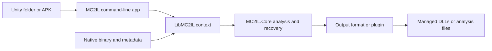

# Architecture

MC2IL takes IL2CPP metadata and a native game binary, analyzes their relationship, and writes managed assemblies or analysis output. Method-body recovery is experimental; the amount of recoverable information depends on the input build.

## Processing flow

The CLI discovers the IL2CPP binary and metadata from supported inputs. `LibMC2IL` parses them into a per-game context. `MC2IL.Core` uses metadata, native code, and architecture-specific decoding to reconstruct method bodies and prepare output. Output formats serialize the resulting model; optional plugins add formats or input handling.

## Projects

| Project | Responsibility |
| --- | --- |
| `MC2IL` | Command-line options, application startup, and output selection |
| `MC2IL.Core` | Analysis pipeline, method-body recovery, and shared output model |
| `LibMC2IL` | IL2CPP metadata, native binary parsing, and per-game contexts |
| `Plugins/*` | Optional input handlers, analysis extensions, and output formats |
| `WasmDisassembler` | WebAssembly instruction decoding support |
| `StableNameDotNet` | Stable names for generated and obfuscated types |
| `LibMC2ILTests`, `MC2IL.Core.Tests` | Unit and regression tests |

## Where to make a change

- Change command-line behavior in `MC2IL` and keep its documentation in the root README current.
- Change metadata or native-binary parsing in `LibMC2IL`; prefer context-based APIs for state associated with a game.
- Change instruction analysis or recovered method bodies in `MC2IL.Core` and include a focused regression case when possible.
- Add an output format or input extension in the relevant plugin project, following the existing plugin structure.

Test fixtures live under `TestFiles/`. Only add files that can be redistributed. Never add proprietary game binaries or metadata without permission; see [CONTRIBUTING.md](../CONTRIBUTING.md).
